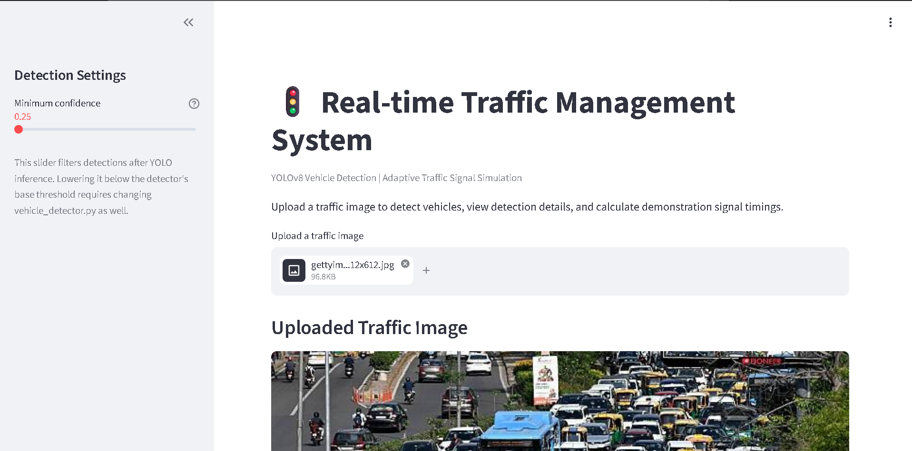
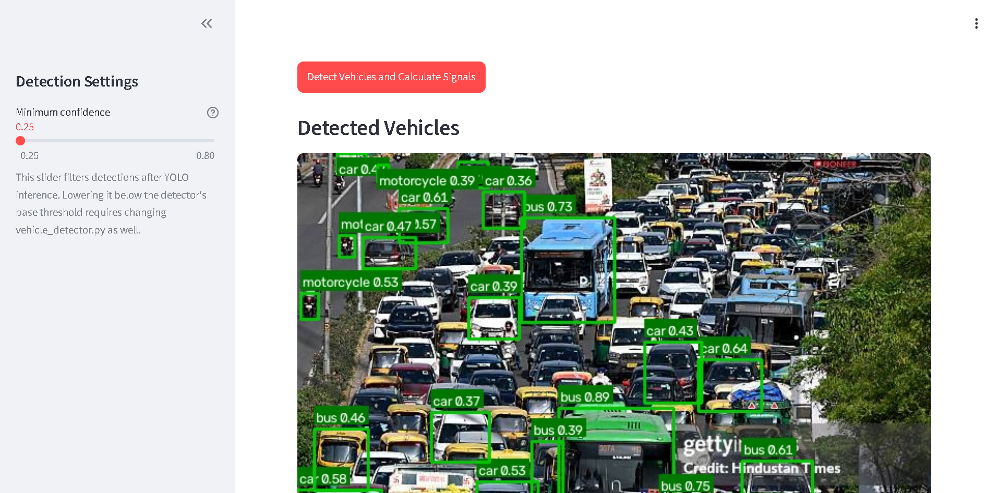
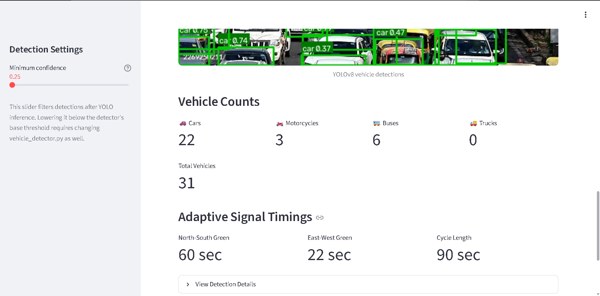

# Real-Time Traffic Management System

A computer vision-based traffic monitoring application that detects vehicles from images and simulates adaptive traffic signal timing based on detected traffic demand.

## Overview

The Real-Time Traffic Management System uses YOLOv8 for vehicle detection and Python-based logic to calculate traffic signal timings. A Streamlit dashboard provides an interactive interface for viewing detection results, vehicle counts, and calculated signal timings.

The project demonstrates how computer vision and adaptive decision logic can be combined to explore smarter traffic management.

## Features

- **Vehicle Detection:** Uses a YOLOv8 model to detect supported vehicle classes in images.
- **Vehicle Classification:** Counts detected cars, motorcycles, buses, and trucks.
- **Adaptive Signal Timing:** Calculates simulated signal timings based on traffic demand.
- **Interactive Dashboard:** Uses Streamlit to display detection results and traffic information.
- **Modular Architecture:** Separates vehicle detection, traffic processing, and signal control into Python modules.
- **Automated Tests:** Includes pytest tests for signal controller and vehicle detector functionality.

## Application Screenshots

### Dashboard Overview


### Vehicle Detection


### Vehicle Counts and Signal Timings



## Technology Stack

- **Language:** Python
- **Computer Vision:** OpenCV, Ultralytics YOLOv8
- **Dashboard:** Streamlit
- **Data Handling:** Pandas
- **Testing:** pytest
- **Version Control:** Git and GitHub

## Project Structure

```text
Real-time-Traffic-Management-System/
├── app.py
├── pyproject.toml
├── requirements.txt
├── requirements-dev.txt
├── README.md
├── .gitignore
├── .streamlit/
│   └── config.toml
├── src/
│   └── traffic_management/
│       ├── __init__.py
│       ├── vehicle_detector.py
│       ├── signal_controller.py
│       └── traffic_processor.py
└── tests/
    ├── __init__.py
    ├── test_signal_controller.py
    └── test_vehicle_detector.py
```

## Getting Started

### Prerequisites

- Python 3.12
- Git
- Internet access for downloading dependencies and YOLO model weights when required

### 1. Clone the repository

```bash
git clone https://github.com/rajlature/Real-time-Traffic-Management-System.git
cd Real-time-Traffic-Management-System
```

### 2. Create a virtual environment

**Windows PowerShell:**

```powershell
py -3.12 -m venv .venv
.\.venv\Scripts\Activate.ps1
```

### 3. Install dependencies

```powershell
python -m pip install --upgrade pip
pip install -e .
pip install -r requirements-dev.txt
```

### 4. Run the application

```powershell
streamlit run app.py
```

Streamlit will provide a local URL in the terminal. Open that URL in your browser to use the dashboard.

## Running Tests

Run the automated tests with:

```powershell
python -m pytest -v
```

## How It Works

1. **Image Input:** The application receives an image for analysis.
2. **Vehicle Detection:** YOLOv8 identifies supported vehicle classes.
3. **Vehicle Counting:** The system counts detected vehicles by class.
4. **Traffic Demand Calculation:** The traffic processor derives a demand value from the detected counts.
5. **Signal Timing Calculation:** The signal controller calculates simulated signal timings.
6. **Dashboard Display:** The application presents the detection results and related traffic information.

## Current Scope and Limitations

- The current workflow processes images; real-time camera-stream processing should not be assumed.
- Traffic signal timings are simulated in software and are not connected to physical traffic lights.
- Traffic demand estimates depend on the quality of vehicle detections.
- Real-world deployment would require additional validation, road-specific logic, and safety considerations.

## Future Improvements

- Process live CCTV or camera streams.
- Evaluate detection accuracy on varied traffic conditions.
- Improve lane-wise vehicle counting and traffic demand estimation.
- Support multiple approaches at an intersection.
- Add emergency vehicle prioritization and route optimization.
- Explore traffic analytics and historical reporting.

## Disclaimer

This project is intended for educational and demonstration purposes. Its simulated signal timings are not intended to control real traffic infrastructure.

## Author

**Channabaswaraj Lature**

GitHub: [rajlature](https://github.com/rajlature)

LinkedIn: [Channabaswaraj Lature](https://www.linkedin.com/in/channabaswaraj-lature-157517323/)
